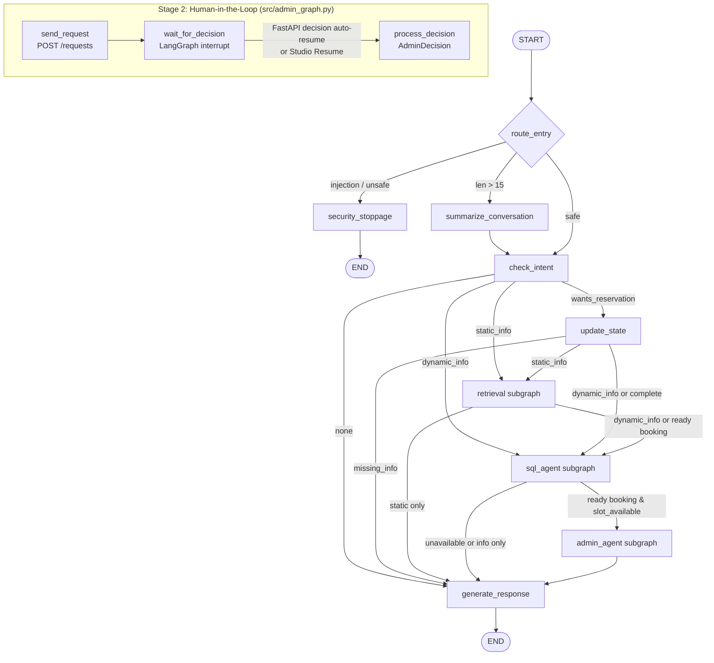
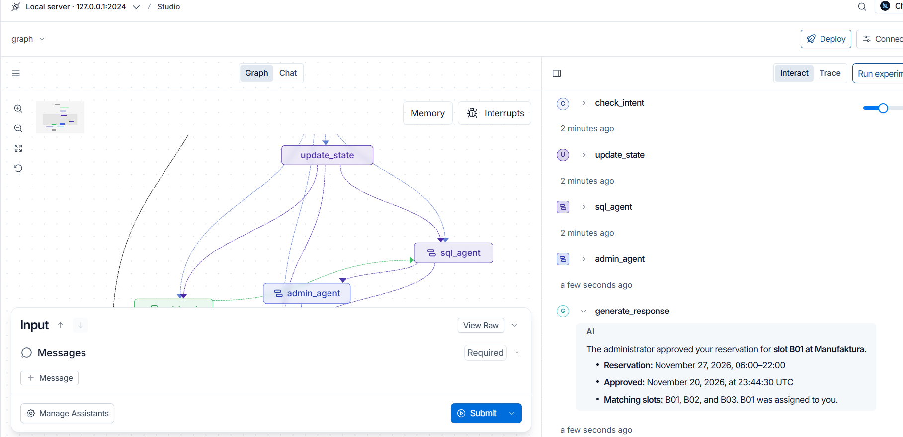
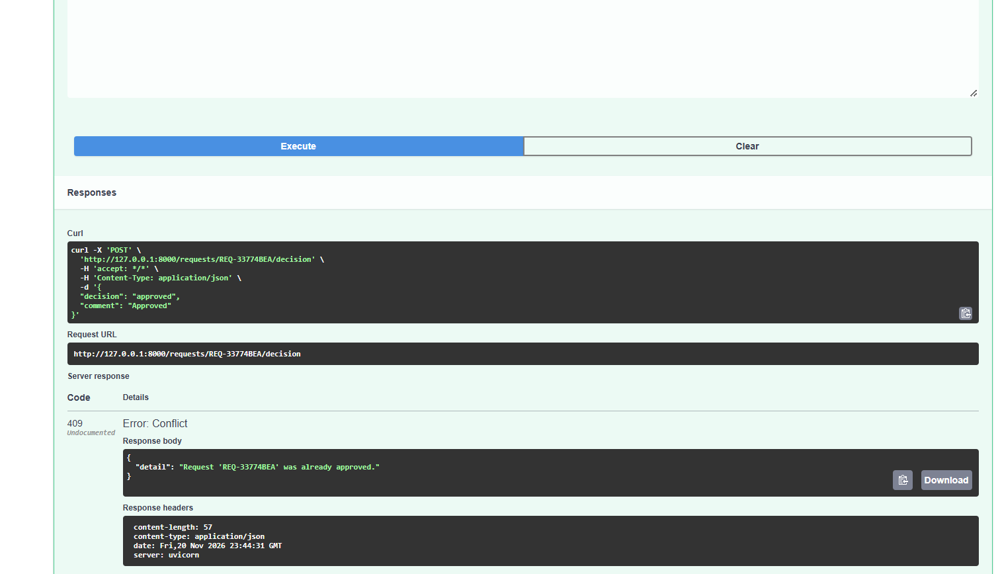

# Parking Space Reservation Chatbot — Stage 2 (Human-in-the-Loop Agent)

An intelligent parking-space assistant built with **Python**, **LangChain**, **LangGraph**, and **FastAPI** as part of the *AI Solution Engineering: Fast Track Course (Module 9)*.

Stage 2 extends the Stage 1 RAG & SQL chatbot with a **Human-in-the-Loop (HITL) administrator approval agent** (`admin_agent` subgraph) backed by **LangGraph `interrupt()`** and a **FastAPI REST API** so validated, available reservations are automatically escalated to a human administrator and resumed once approved or refused.

---

## Key Features

### Stage 2 — Human-in-the-Loop Administrator Agent
- **Dedicated Second LangChain Agent (`src/admin_graph.py`):** Compiled as a 3-node LangGraph subgraph (`send_request` → `wait_for_decision` → `process_decision`):
  1. **`send_request`:** Uses LangChain (`ADMIN_REQUEST_PROMPT`) to draft a concise reservation approval request and sends it via the `send_admin_request` tool to the FastAPI Admin API, including the LangGraph `thread_id`.
  2. **`wait_for_decision`:** Side-effect-free node calling LangGraph `interrupt(...)` to pause graph execution cleanly (resuming never duplicates the outbound API request).
  3. **`process_decision`:** Interprets the administrator's reply (JSON from FastAPI or natural language from LangGraph Studio) into a structured `AdminDecision(status, reason, approval_time)` using LangChain structured output and updates `user_info.approval_time` when approved.
- **FastAPI Administrator REST API (`src/admin_api.py`):**
  - `POST /requests` — registers a pending reservation request and returns a `request_id` (e.g. `REQ-33774BEA`).
  - `GET /requests` — lists requests (filterable by `?status=pending|approved|refused`).
  - `GET /requests/{request_id}` — inspects an individual request.
  - `POST /requests/{request_id}/decision` — records `approved` or `refused` with an optional comment and UTC `approval_time`, rejects duplicate decisions with `409 Conflict`, and **automatically resumes** the paused LangGraph Server thread (`POST /threads/{thread_id}/runs`).
- **Conditional Escalation from Agent 1 → Agent 2:** `sql_agent` now returns structured `slot_available` and `assigned_slot` fields when reviewing a booking. `graph/graph.py` escalates to `admin_agent` **only** when all user reservation details are valid **and** SQL confirms an available slot.

### Stage 1 — RAG Chatbot, Guardrails & Evaluation (Included)
- **Static + Dynamic Data Split:** ChromaDB + BM25 hybrid retrieval (`0.60` / `0.40`) for 14 policy/location PDFs; read-only SQLite ReAct agent (`data/parking.db`) for November 2026 availability, opening hours, and hourly prices.
- **Multi-Layer Guardrails:** Regex + LLM prompt-injection checks (`InputSanitizer`, `SecutiryGuard`), read-only SQL authorizer with call budget (`MAX_SQL_CALLS = 3`), and local NLP PII redaction via **Microsoft Presidio + spaCy `en_core_web_sm`** on both vector DB chunks and SQL rows.
- **RAG Evaluation & CI:** Automated `Recall@K`, `Precision@K`, `MRR`, and latency reporting ([eval/report.md](eval/report.md)) plus 39 `pytest` unit tests running on GitHub Actions.

---

## Architecture



---

## Screenshots (Live End-to-End Demo)

### 1. LangGraph Studio — Escalation, Resume & User Confirmation
The main graph validates the reservation, checks availability via `sql_agent`, escalates to `admin_agent`, pauses on `interrupt()`, and resumes automatically once the administrator approves `REQ-33774BEA` via FastAPI to deliver the final confirmation:



### 2. FastAPI Admin REST API (`/docs`) — Decision & Duplicate Protection
The administrator reviews pending requests and submits approve/refuse decisions directly via FastAPI's interactive Swagger UI (`POST /requests/{request_id}/decision`). Re-submitting an already processed request is safely rejected with `409 Conflict`:



---

## Project Structure

```text
parking_project/
├── .github/workflows/
│   └── tests.yml                # GitHub Actions CI (uv sync --locked + pytest)
├── data/
│   ├── chroma_db/               # Persisted Chroma vector database (static PDFs)
│   └── parking.db               # SQLite database (dynamic slots, prices, hours)
├── docs/
│   ├── image.png                # FastAPI Admin API decision screenshot
│   └── langsmith.png            # LangGraph Studio end-to-end approval screenshot
├── eval/
│   ├── dataset.json             # 12 ground-truth RAG evaluation queries
│   ├── evaluate_rag.py          # Recall@K, Precision@K, MRR, latency evaluator
│   └── report.md                # Generated RAG evaluation report
├── graph/
│   └── graph.py                 # Main LangGraph workflow orchestrating all subgraphs
├── seed_ingest/
│   ├── pdfs/                    # 14 fictional parking policy & location PDFs
│   ├── dynamic_data.py          # Generates data/parking.db (360 November 2026 slots)
│   └── static_data.py           # Ingests PDFs into data/chroma_db
├── src/
│   ├── admin_api.py             # Stage 2: FastAPI REST API + LangGraph auto-resume
│   ├── admin_graph.py           # Stage 2: Human-in-the-Loop admin approval subgraph
│   ├── functions.py             # Retrievers, helpers, Presidio/spaCy PII redaction
│   ├── guardrails.py            # InputSanitizer and safe_sql validation
│   ├── models_vector.py         # OpenAI LLM/embedding & Chroma initialization
│   ├── prompts.py               # Prompts for routing, RAG, SQL, admin agent, responses
│   ├── react_graph.py           # Read-only SQL ReAct subgraph + availability check
│   ├── retrieval_graph.py       # Hybrid RAG + grading/rewrite subgraph
│   ├── schema.py                # Pydantic state, SQL availability & AdminDecision schemas
│   └── security.py              # LLM-based SecutiryGuard classifier
├── tests/
│   ├── test_admin_api.py        # FastAPI Admin API & auto-resume unit tests
│   ├── test_admin_graph.py      # Admin subgraph interrupt(), idempotency & decision tests
│   ├── test_eval.py             # RAG evaluation metrics & report unit tests
│   ├── test_guards.py           # Prompt-injection detection & sanitization tests
│   └── test_pii.py              # Presidio + spaCy PII redaction & SQL row tests
├── langgraph.json               # LangGraph Server / Studio configuration
├── pyproject.toml               # Dependencies & pytest config (managed by uv)
└── uv.lock                      # Cross-platform lockfile
```

---

## Setup

### Prerequisites
- Python **3.12**
- [uv](https://docs.astral.sh/uv/) package manager
- OpenAI API key (`OPENAI_API_KEY`)

### 1. Clone & Install Dependencies
```bash
git clone <your-repo-url>
cd parking_project
uv sync --locked
```

### 2. Configure Environment Variables
Create a `.env` file in the project root:
```env
OPENAI_API_KEY=your_openai_api_key

# Optional overrides (defaults shown)
ADMIN_API_URL=http://127.0.0.1:8000
LANGGRAPH_API_URL=http://127.0.0.1:2024
LANGGRAPH_ASSISTANT_ID=graph
```

### 3. (Optional) Regenerate Data Fixtures
Pre-seeded `data/parking.db` and `data/chroma_db/` are included. To rebuild them from scratch:
```bash
uv run python -m seed_ingest.dynamic_data
uv run python -m seed_ingest.static_data
```

---

## Usage (Running Stage 2 End-to-End)

Start both local servers in separate terminals:

```bash
# Terminal 1 — FastAPI Admin REST API (Swagger UI at http://127.0.0.1:8000/docs)
uv run uvicorn src.admin_api:app --port 8000

# Terminal 2 — LangGraph Dev Server / Studio (port 2024)
uv pip install "langgraph-cli[inmem]"
uv run langgraph dev
```

### Approval Workflow
1. **User submits reservation details** in LangGraph Studio (name, car plate, venue, date, arrival & departure time).
2. **`sql_agent` verifies availability** in `data/parking.db` and selects an available slot (e.g. `B01`).
3. **`admin_agent` sends the request** (`POST /requests`) to FastAPI and pauses via `interrupt()`.
4. **Administrator reviews & decides** via FastAPI Swagger (`http://127.0.0.1:8000/docs`) or HTTP:
   - List pending requests: `GET /requests?status=pending`
   - Approve or refuse:
     ```bash
     curl -X POST http://127.0.0.1:8000/requests/<REQUEST_ID>/decision \
       -H "Content-Type: application/json" \
       -d '{"decision": "approved", "comment": "Approved"}'
     ```
5. **Auto-resume & user reply:** FastAPI records the decision with a UTC `approval_time` and automatically resumes the paused LangGraph thread so the chatbot delivers the final confirmation (or refusal reason) to the user.

---

## RAG Evaluation (Stage 1 Baseline)

Re-run the retrieval evaluation against [eval/dataset.json](eval/dataset.json):
```bash
uv run python -m eval.evaluate_rag
```

Latest measured metrics ([eval/report.md](eval/report.md)):

| Metric | @1 | @4 |
| --- | ---: | ---: |
| **Recall** | 0.875 | 1.000 |
| **Precision** | 1.000 | 0.312 |
| **MRR** | 1.000 | 1.000 |

| Avg Latency | p50 Latency | p95 Latency | Max Latency |
| ---: | ---: | ---: | ---: |
| 426.2 ms | 199.9 ms | 1339.6 ms | 2247.3 ms |

---

## Testing & CI/CD

Run the full automated test suite (runs completely offline with no API key required):
```bash
uv run pytest tests/ -v
```

| Test Module | Tests | Coverage |
| --- | ---: | --- |
| [tests/test_admin_api.py](tests/test_admin_api.py) | 4 | Request creation/listing, approve/refuse, `404`/`409` handling, LangGraph auto-resume callback |
| [tests/test_admin_graph.py](tests/test_admin_graph.py) | 2 | Subgraph `interrupt()` pause & `Command(resume=...)`, idempotency, approved/refused parsing |
| [tests/test_eval.py](tests/test_eval.py) | 4 | `Recall@K`, `Precision@K`, `MRR@K`, percentiles, evaluator runner & report generation |
| [tests/test_guards.py](tests/test_guards.py) | 24 | Prompt-injection regex detection and input sanitization |
| [tests/test_pii.py](tests/test_pii.py) | 5 | Local Presidio + spaCy PII redaction, public parking allow-list, SQL row sanitization |

GitHub Actions ([.github/workflows/tests.yml](.github/workflows/tests.yml)) automatically runs `uv sync --locked` and `uv run python -m pytest tests/ -v` on every push and pull request.

---

## Roadmap

- **Stage 3:** Secure MCP server to persist approved reservations (`Name | Car Number | Reservation Period | Approval Time`).
- **Stage 4:** Full end-to-end LangGraph orchestration with MCP recording, load testing, and integration tests.
